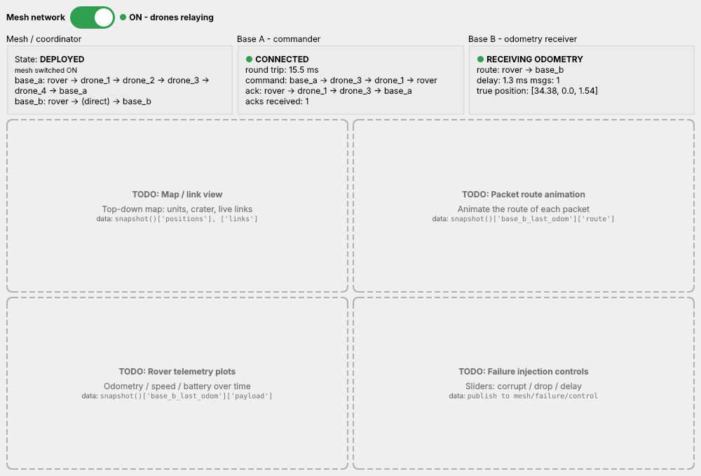

<!-- mars-mesh-readme -->
# Mars Rover Relay Mesh — Simulation

A ROS 2 + Gazebo simulation of a rover that loses contact with its base station inside a crater. A team of 4 relay drones forms a **mesh network** (our own protocol, on **[Zenoh](https://zenoh.io)**) that keeps the rover connected to **two base stations**: base A drives the rover, and base B receives its odometry.

   


**Contents:** [1 Idea](#1-the-idea) · [2 Status](#2-what-works-now) · [3 Setup](#3-setup-on-a-new-laptop-once) · [4 Run the demo](#4-run-the-demo) · [5 World](#5-the-world-simulation-reference) · [6 How the network works](#6-how-the-network-works) · [7 Programs](#7-programs-and-commands) · [8 Where to plug in your part](#8-where-to-plug-in-your-part) · [9 Changing things](#9-changing-things) · [10 Repo layout](#10-repository-layout) · [11 Team workflow](#11-team-workflow-git) · [12 Troubleshooting](#12-troubleshooting) · [13 Roadmap](#13-roadmap)

---

## 1. The idea

```
   base A ─────────────── (crater) ─────────────── base B
  commands                                       receives odometry
     ▲    ✈ drone_2 ── ✈ drone_1        ✈ drone_3 ── ✈ drone_4    │
     └──────┘             \             /                └────────┘
                           \  rover  ●  /      the crater rim blocks every
                              (crater floor)   direct line to both bases
```

1. The **rover** starts next to **base A** and drives through a crater to **base B**.
2. Base A sends the rover **velocity commands**, and the rover answers each one with an **ACK**. The rover sends its **odometry** to base B.
3. Radio links only work with **line of sight over the terrain** and within **32 m**. Inside the crater the rim blocks both bases, so the rover stops (safety watchdog).
4. Switch the **mesh network ON** (GUI toggle). The 4 drones fly to relay positions, forming one chain to each base. Both links come back, the rover drives on, and base B gets odometry **all the way to the end**.
5. A failure injector can corrupt or drop packets. CRC checks catch every broken packet, and nothing crashes.

## 2. What works now

| Part | What it does | Package (`src/`) | Status |
|---|---|---|---|
| World | 110 × 60 m crater terrain, rover, 4 drones, **2 base stations** | `mars_sim` | ✅ |
| Shared definitions | Unit names, layout, Zenoh keys, packet format + CRC32 | `mesh_common` | ✅ |
| Link model | Line of sight over the real terrain + radio range → which links are up | `mesh_link_model` | ✅ |
| Radio channel | Delivers a packet only to units with a working link | `mesh_link_model` | ✅ |
| Failure injection | **Stand-in only** (`passthrough_injector`: corrupt / drop for tests). Full module still to come | `mesh_link_model` → `failure_injection` | 🟡 |
| Mesh protocol v2 | One node per unit: HELLO neighbours, flooding with duplicate filter + TTL, CRC check, COMMAND / ACK / TELEMETRY | `mesh_protocol` | ✅ |
| Coordinator | Mesh ON/OFF switch; plans and moves the 4 relay drones, follows the rover | `mesh_protocol` | ✅ |
| Mission autopilot | Base A drives the rover from base A to base B over the mesh | `mesh_protocol` | ✅ |
| Monitor | Live text view of both bases, links and counters | `mesh_protocol` | ✅ |
| Base station GUI | **Placeholder** (PyQt6): working mesh toggle + status, TODO boxes for the rest | `base_station_gui` | 🟡 |
| Self-test | Whole demo without Gazebo, 19 checks (~2 min) | `mesh_protocol` | ✅ |

Gazebo is reached with the **Gazebo Python bindings** (`gz.transport13`): positions come from `/world/mars_world/pose/info`, the rover is driven on `/rover/cmd_vel`, and drones move with the `set_pose` service. No ROS 2 bridge is needed for the demo.

## 3. Setup on a new laptop (once)

**You need:** Ubuntu 24.04 (dual boot / native is best; WSL2 works too) and about 15 GB free.

> 📶 **On campus Wi-Fi?** If a download fails with `SSL certificate problem: self-signed certificate`, use a phone hotspot for the setup.

Open a terminal (`Ctrl + Alt + T`) and run each block in order.

**Step 1: Language settings** (ROS 2 needs UTF-8)
```bash
sudo apt update && sudo apt install -y locales
sudo locale-gen en_US en_US.UTF-8
sudo update-locale LC_ALL=en_US.UTF-8 LANG=en_US.UTF-8
export LANG=en_US.UTF-8
```

**Step 2: Add the ROS 2 package source**
```bash
sudo apt install -y software-properties-common curl
sudo add-apt-repository -y universe
export ROS_APT_SOURCE_VERSION=$(curl -s https://api.github.com/repos/ros-infrastructure/ros-apt-source/releases/latest | grep -F "tag_name" | awk -F'"' '{print $4}')
curl -L -o /tmp/ros2-apt-source.deb "https://github.com/ros-infrastructure/ros-apt-source/releases/download/${ROS_APT_SOURCE_VERSION}/ros2-apt-source_${ROS_APT_SOURCE_VERSION}.$(. /etc/os-release && echo ${UBUNTU_CODENAME:-${VERSION_CODENAME}})_all.deb"
sudo dpkg -i /tmp/ros2-apt-source.deb
```

**Step 3: ROS 2 Jazzy + build tools**
```bash
sudo apt update && sudo apt upgrade -y
sudo apt install -y ros-jazzy-desktop ros-dev-tools git
echo "source /opt/ros/jazzy/setup.bash" >> ~/.bashrc
source ~/.bashrc
```

**Step 4: Gazebo Harmonic + the ROS–Gazebo packages**
```bash
sudo curl https://packages.osrfoundation.org/gazebo.gpg --output /usr/share/keyrings/pkgs-osrf-archive-keyring.gpg
echo "deb [arch=$(dpkg --print-architecture) signed-by=/usr/share/keyrings/pkgs-osrf-archive-keyring.gpg] http://packages.osrfoundation.org/gazebo/ubuntu-stable $(lsb_release -cs) main" | sudo tee /etc/apt/sources.list.d/gazebo-stable.list > /dev/null
sudo apt update && sudo apt install -y gz-harmonic ros-jazzy-ros-gz
```
> ⚠️ Use **Gazebo Harmonic** (`gz sim`) only. Do **not** install Gazebo Classic (`gazebo`, `gazebo11`, `gazebo_ros`).

**Step 5: Python parts used by the mesh** (Gazebo Python bindings, numpy, PyQt6, Zenoh)
```bash
sudo apt install -y python3-gz-transport13 python3-gz-msgs10 python3-numpy python3-pyqt6 python3-pip
pip install --user --break-system-packages eclipse-zenoh
```

**Step 6: Check everything works.** Open a **new** terminal:
```bash
echo $ROS_DISTRO                                               # → jazzy
gz sim --version                                               # → Gazebo Sim, version 8.x
python3 -c "import zenoh, numpy, gz.transport13; print('python OK')"
python3 -c "import PyQt6.QtWidgets; print('PyQt6 OK')"
```

**Step 7: Get access + log in to GitHub.** The repo is **private**. Ask the owner to add you (repo → Settings → Collaborators), accept the invite, then:
```bash
sudo apt install -y gh
git config --global user.name "Your Name"
git config --global user.email "you@example.com"        # the email on your GitHub account
gh auth login --hostname github.com --git-protocol https --web
gh auth setup-git
```

**Step 8: Clone, build, test.** This repository **is** the ROS 2 workspace. Always clone it into `~/mars_ws`:
```bash
git clone https://github.com/Project-Kratos-28/auto_openday_mesh_networking_project.git ~/mars_ws
cd ~/mars_ws
colcon build --symlink-install
source install/setup.bash
echo "source ~/mars_ws/install/setup.bash" >> ~/.bashrc    # optional: every new terminal knows our packages
ros2 run mesh_protocol selftest                            # ~2 min, should end with 19/19 checks passed
```

## 4. Run the demo

Open 4 terminals. In **each** one run `cd ~/mars_ws && source install/setup.bash` first (skip this if you added it to `~/.bashrc`).

| Terminal | Command | What it is |
|---|---|---|
| T1 | `ros2 launch mars_sim sim.launch.py` | Gazebo with the crater world (press ▶ if paused) |
| T2 | `ros2 launch mesh_protocol mesh.launch.py` | link model, radio, injector, 7 mesh nodes, coordinator. **Mesh starts OFF** |
| T3 | `ros2 run base_station_gui gui` | base station window with the **mesh ON/OFF toggle** |
| T4 | `ros2 run mesh_protocol mission` | base A drives the rover to base B (1 m/s, about 70 s) |

Optional T5: `ros2 run mesh_protocol mesh_monitor` (text view of everything).

**What you'll see:**

1. **Mesh OFF.** Base A is CONNECTED (`base_a → rover`) and base B shows NO DATA.
2. **Link lost.** About 6 m past the rim the terrain blocks base A. Base A shows NO CONNECTION, and the rover stops after 2 s (safety watchdog).
3. **Flip the toggle ON.** All 4 drones jump to relay spots about 9 m up. Base A is connected again (`base_a → drone_2 → drone_1 → rover`) and base B starts RECEIVING odometry (`rover → drone_3 → drone_4 → base_b`). The rover drives on.
4. **Follow.** The drones are moved ahead of the rover, one at a time, so neither chain ever breaks. Near base B all 4 drones form one chain back to base A.

To get odometry for the **whole** trip, switch ON before starting T4 (or launch with `mesh:=on`). In Gazebo, scroll out until both base stations are visible, or right-click `primary_rover` in the Entity Tree → **Follow**.



**Without Gazebo** (fake rover, good for working on the protocol or GUI):
```bash
ros2 launch mesh_protocol mesh.launch.py fake:=true mission:=true gui:=true
```

## 5. The world (simulation reference)

**World name:** `mars_world` · gravity **3.71 m/s²** (Mars) · metres · crater centre = origin `(0, 0)` · route along the x axis.

| Entity | Gazebo name | Mesh name | Position (x, y, z) | Notes |
|---|---|---|---|---|
| Terrain | `mars_crater` | — | — | 110 × 60 m. Crater 36 m wide: floor z = 0, rim top z = 6 at r = 18 m, plain z ≈ 1.5 |
| Base A | `base_station` | `base_a` | (-40, 0, 1.62) | Sends commands. 10 × 10 m pad, antenna ≈ 10.5 m above the pad |
| Base B | `base_station_2` | `base_b` | (40, 0, 1.38) | Receives odometry |
| Rover | `primary_rover` | `rover` | (-32, 0, 1.82) | 1 m, diff drive, faces +x. Antenna 1.3 m up |
| Drones | `drone_1` … `drone_4` | same | parked at (-48, ±3), (-51, ±3), 3 m up | Static (hover where placed), moved with `set_pose` |

- **Radio:** a link is up when the distance is ≤ **32 m** and the straight line between the two antennas stays **0.5 m above the ground** everywhere.
- **Bases A ↔ B** (80 m) can never talk directly.
- **Rover ↔ base A** breaks at x ≈ -11.5 (terrain).

Gazebo topics and services used:

| Name | Type | Used for |
|---|---|---|
| `/rover/cmd_vel` | `gz.msgs.Twist` | drive the rover (sent by the rover's mesh node) |
| `/rover/odom` | `gz.msgs.Odometry` | rover wheel odometry (sent to base B) |
| `/world/mars_world/pose/info` | `gz.msgs.Pose_V` | true positions of all units (link model) |
| `/world/mars_world/set_pose` | service `gz.msgs.Pose` | teleport drones (coordinator) |

## 6. How the network works

### Packet path

A packet never goes straight from one unit to another:
```
 [unit node] ─ mesh/<u>/tx ─► radio channel ─ mesh/<v>/air ─► failure injector ─ mesh/<v>/rx ─► [unit v node]
                              (only to units with a                  (corrupt / drop)
                               working link: mesh/links)
 Gazebo poses ─► link model ─► mesh/links, mesh/positions    (5 times a second)
```

### Units and roles

| Mesh name | Role |
|---|---|
| `base_a` | **Commander.** Turns `mesh/base_a/cmd` into COMMAND packets, pings the rover every 1 s when idle, and publishes every ACK on `mesh/base_a/acks` |
| `rover` | Applies COMMANDs, answers each with an ACK, sends odometry (TELEMETRY) to base B every 0.5 s. **Watchdog:** stops if no drive command for 2 s |
| `base_b` | **Receiver.** Publishes the rover's odometry on `mesh/base_b/telemetry` |
| `drone_1` … `drone_4` | **Relays only**, and only while the coordinator says the mesh is ON |

### Protocol rules (`mesh_protocol/mesh_node.py`)
- **HELLO** every 1 s (TTL 1, never forwarded). A neighbour is gone after 3 s without one.
- **Flooding:** a drone re-sends every new packet that isn't for it. Bases and the rover never forward.
- **Duplicate filter:** `(src, type, seq)` is remembered, so each packet is forwarded once. Each packet type has its own `seq` counter.
- **TTL** starts at 8 and drops by 1 per hop; at 0 the packet is dropped. `path` lists every unit it passed.
- **CRC32 + parse check:** broken packets are counted (`bad_crc`) and dropped. They never crash a node.

### Packet format (JSON, defined in `mesh_common`)
```json
{"src": "rover", "dst": "base_b", "next_hop": "*", "seq": 42, "ttl": 8,
 "path": ["rover", "drone_3"], "type": "TELEMETRY", "sent_time": 1729071234.5,
 "payload": {"odom": {"x": 1.2, "y": 0.0, "yaw": 0.01, "v": 1.0}, "truth": {"pos": [1.2, 0.0, 0.1]},
             "moving": true, "battery": 99.5},
 "crc32": 3735928559}
```
`type` is `HELLO`, `COMMAND` (base A → rover, e.g. `{"linear": 1.0, "angular": 0.0}` or `{"ping": true}`), `ACK` (rover → base A) or `TELEMETRY` (rover → base B).

### Coordinator: the mesh switch (`mesh_protocol/coordinator.py`)
| Mode | Behaviour |
|---|---|
| `off` (default) | Drones parked behind base A, relaying off. Direct links only |
| `on` | Drones deploy **at once**, wherever the rover is, and follow it |
| `auto` | Stay parked until base A hears nothing from the rover for 3 s, then deploy |

While deployed, the coordinator works like this:
- **Checks:** every 0.5 s it tests both chains, for where the rover is now and where it'll be in 3 s.
- **Re-plans:** when a chain would break, or after the rover moves 8 m.
- **Planner** (`mesh_link_model/planner.py`): for each base, it tries 0, 1, 2… drones spaced along the line rover → base, at 3 / 6 / 10 / 15 m above the ground. It uses the fewest that give every hop line of sight and range, and spare drones go to the chain with the longest hop, so all 4 always help.
- **Moving drones:** one at a time, in an order that keeps both chains working at every step.

### Zenoh keys
| Key | From → To | Contents |
|---|---|---|
| `mesh/<unit>/tx` · `/air` · `/rx` | see packet path | raw packets |
| `mesh/links` | link model → all | `{"links": [{"a","b","up","distance","in_range","los","quality"}]}` |
| `mesh/positions` | link model → all | true `x, y, z` and `yaw` of every unit |
| `mesh/stats/<unit>` | each node → GUI | sent / received / forwarded / delivered / duplicates / bad_crc, neighbours, relay on/off |
| `mesh/base_a/cmd` | mission, GUI → base A | velocity command `{"linear", "angular"}` |
| `mesh/base_a/acks` | base A → GUI | every ACK: round trip, command route, ACK route |
| `mesh/base_b/telemetry` | base B → GUI | odometry + route + delay |
| `mesh/coordinator/cmd` | GUI toggle, `mesh_ctl` → coordinator | `on` / `off` / `auto` / `deploy` |
| `mesh/coordinator/state` | coordinator → drones, GUI | mode, state, relay, chains, drone targets |
| `mesh/mission/status` | mission → GUI | rover x, progress %, assists |
| `mesh/failure/control` | GUI, terminal → injector | e.g. `{"corrupt_probability": 0.2, "drop_probability": 0.05}` |
| `mesh/failure/events` | injector → GUI | each corrupt / drop event |

All programs connect only on **`127.0.0.1`** (one hub at `tcp/127.0.0.1:7447`, multicast off), so nothing leaks onto hostel Wi-Fi. That also means everything must run on **one laptop** for now (see section 12).

## 7. Programs and commands

| Command | What it does |
|---|---|
| `ros2 launch mesh_protocol mesh.launch.py` | Starts everything below except the mission and the GUI. Options: `mesh:=on`, `gui:=true`, `mission:=true`, `fake:=true` (no Gazebo), `injector:=none` (use the real injector), `sim:=true` (also start Gazebo) |
| `ros2 run mesh_protocol mesh_ctl on\|off\|auto\|deploy` | The mesh switch from a terminal (the GUI toggle follows it) |
| `ros2 run mesh_protocol mission [--speed 0.5] [--no-assist]` | Drive base A → base B. Assist: if the rover gets commands but is stuck for 6 s, it's lifted 1.5 m forward |
| `ros2 run mesh_protocol mesh_monitor` | Live text view |
| `ros2 run mesh_protocol send_cmd 1.0 [0.2]` | One drive command from base A (0 = stop) |
| `ros2 run mesh_protocol move_unit drone_1 0 0 12` / `move_unit home` | Teleport a unit / park all drones (`--fake` without Gazebo) |
| `ros2 run mesh_protocol selftest` | Whole demo without Gazebo, 19 checks |
| `ros2 run base_station_gui gui` | GUI placeholder |
| `ros2 run mesh_protocol coordinator --start on` · `mesh_node --unit drone_1` · `ros2 run mesh_link_model link_model` / `radio_channel` / `passthrough_injector` | Single pieces (normally started by the launch file) |

## 8. Where to plug in your part

**Failure injection team:**
- Write `src/failure_injection`. It subscribes to `mesh/*/air`, changes, drops or delays the raw bytes, and publishes to `mesh/<unit>/rx`. Copy the interface of `mesh_link_model/passthrough_injector.py`: same keys, plus live settings on `mesh/failure/control` and events on `mesh/failure/events`.
- Run the mesh with `injector:=none` and start yours instead.
- Never decode packets in the injector. Flip bits in the bytes; the nodes must survive it.

**GUI team:** `src/base_station_gui` is a **placeholder** (see its `README.md`):
- `mesh_bridge.py` holds all Zenoh in/out and has no Qt code. `set_mesh(True/False)` is the toggle, and `snapshot()` returns positions, links, chains, both base feeds and the mission status. **Keep this file and use it in the real GUI.**
- `app.py` is the PyQt6 window with the working toggle and 3 status cards, plus 4 dashed TODO boxes (map, packet routes, telemetry plots, failure controls).
- Merging your existing GUI: put it in this package (or yours), create one `MeshBridge`, connect your switch to `set_mesh`, and in a Qt timer set the switch from `snapshot()["mesh_mode"]`. Never call Zenoh from widgets.
- Once the GUI is yours, delete `src/base_station_gui/PLACEHOLDER_MARKER`. Setup scripts only ever replace a folder that still has this file.

**Protocol team:**
- Everything is in `mesh_protocol/mesh_node.py` (one class, one copy per unit).
- Next steps are in the roadmap: routing table instead of flooding, ACK + retransmit for telemetry.
- Keep the packet format and keys in `mesh_common`. Run `ros2 run mesh_protocol selftest` before pushing.

**Simulation:** see section 9.

## 9. Changing things

| I want to change... | Edit | Then |
|---|---|---|
| Crater size / depth / bumps, terrain size | numbers at the top of `src/mars_sim/scripts/generate_crater.py` | regenerate (below) |
| Where the bases, rover or parked drones start | `src/mars_sim/scripts/build_relay_world.py` **and** `START_XY` in `src/mesh_common/mesh_common/__init__.py` | regenerate (below) |
| Radio range, antenna heights, rover speed, relay heights, goal | `src/mesh_common/mesh_common/__init__.py` (`RADIO_RANGE`, `ANTENNA_HEIGHT`, `ROVER_SPEED`, `RELAY_HEIGHTS`, `REPLAN_DISTANCE`, `GOAL_X`) | relaunch |
| Rover / drone / base shape | `src/mars_sim/models/<model>/model.sdf` | relaunch |
| Gravity, sun, sky | `build_relay_world.py` (the world file is generated) | regenerate |

Regenerate the terrain and world:
```bash
cd ~/mars_ws/src/mars_sim && python3 scripts/generate_crater.py && python3 scripts/build_relay_world.py
cd ~/mars_ws && colcon build --symlink-install
ros2 run mesh_protocol selftest              # check the demo still works
```
- **Never hand-edit** `worlds/mars_crater.sdf` or `models/mars_crater/meshes/crater.obj`: both are generated. Commit them **together with** the scripts.
- Changed the crater, radio range or positions? Check the story still works: the rover must lose base A inside the crater, and the bases must not see each other. Run the self-test, and update section 5.
- Keep the names stable (`mars_world`, `primary_rover`, `drone_1…4`, `base_station`, `base_station_2`, topics, Zenoh keys). Other packages depend on them.

## 10. Repository layout

```
mars_ws/                              ← repo root = ROS 2 workspace
├── README.md                         ← this file
├── ERRORS.md                         ← problems we hit + how we fixed them
├── docs/
│   ├── RELAY_DEMO.md                 ← short demo guide
│   └── images/                       ← pictures used in the README
└── src/
    ├── mars_sim/                     ← Gazebo world, models, launch (ament_cmake)
    │   ├── scripts/generate_crater.py    ← makes models/mars_crater/meshes/crater.obj
    │   ├── scripts/build_relay_world.py  ← makes worlds/mars_crater.sdf
    │   ├── worlds/  models/  launch/sim.launch.py
    ├── mesh_common/                  ← names, layout, Zenoh keys, packet format + CRC
    ├── mesh_link_model/              ← terrain + line of sight, link model, radio channel,
    │                                    relay planner, teleport helper, stand-in injector
    ├── mesh_protocol/                ← mesh node, coordinator, mission, tools, self-test, launch
    └── base_station_gui/             ← GUI PLACEHOLDER (PyQt6) + mesh_bridge.py
```
`build/`, `install/` and `log/` come from `colcon build` and are **not** in git.

## 11. Team workflow (git)

```bash
cd ~/mars_ws && git checkout main && git pull       # ALWAYS first
git checkout -b feature/<short-name>                # e.g. feature/failure-injection
# ... edit, then build and test:
colcon build --symlink-install && source install/setup.bash && ros2 run mesh_protocol selftest
git add -A && git commit -m "Add bit-flip injector" && git push -u origin feature/<short-name>
```
Then open a **Pull Request** on GitHub so someone checks it before it's merged.

Team rules:
- Pull before you start, push when you stop.
- One person per file at a time. Say in the group chat which file you're editing.
- Don't commit `build/`, `install/` or `log/`.

**If git says "conflict":** open the file, keep the right lines, delete the `<<<<<<<`, `=======` and `>>>>>>>` markers, then:
```bash
git add -A && git commit -m "Merge latest main" && git push
```
Not sure which version is right? Ask whoever made the other change.

## 12. Troubleshooting

| Problem | Fix |
|---|---|
| `ModuleNotFoundError: No module named 'zenoh'` | `pip install --user --break-system-packages eclipse-zenoh` |
| `No module named 'gz.transport13'` | `sudo apt install -y python3-gz-transport13 python3-gz-msgs10` |
| `No module named 'PyQt6'` | `sudo apt install -y python3-pyqt6` |
| `qt.qpa.plugin: Could not load the Qt platform plugin "xcb"` | `sudo apt install -y libxcb-cursor0` |
| `error: externally-managed-environment` (pip) | add `--break-system-packages` |
| `No module named mesh_common` / `Package 'mesh_protocol' not found` | `cd ~/mars_ws && source install/setup.bash` in that terminal |
| `[link_model] WARNING: no position yet` | Gazebo isn't running or is paused (press ▶). Check `gz topic -l \| grep pose` |
| GUI: "coordinator not running" | Start T2 first |
| Drones don't move | Check `gz service -l \| grep set_pose`; the world must be `mars_world` |
| Rover doesn't move | Mesh OFF and rover in the crater = no link (that's the demo). Otherwise press ▶ or check `gz topic -l \| grep rover` |
| `ASSIST #n` lines in the mission | The rover slipped on the ~31° crater wall and was lifted forward. Occasional is fine |
| `Address already in use` (port 7447) | An old launch is still running: `pkill -f "mesh_protocol\|mesh_link_model"` |
| GUI on another laptop sees nothing | On purpose for now: everything only connects on 127.0.0.1 (one laptop). Running the GUI on a second laptop needs a Zenoh network config change; ask the sim team first |
| Self-test fails | Read the `FAIL` lines and `/tmp/mesh_selftest.log` |
| `SSL certificate problem` on campus Wi-Fi | Use a phone hotspot |
| `Unable to find uri[model://...]` | `colcon build --symlink-install && source install/setup.bash` |
| Black window / crash | `sudo ubuntu-drivers install`, reboot |

More in [`ERRORS.md`](ERRORS.md).

## 13. Roadmap

- [x] World: crater terrain, rover, 4 drones, **2 base stations** (small demo scale)
- [x] Shared definitions (`mesh_common`): packet format + CRC32, unit names, Zenoh keys
- [x] Link model + radio channel: line of sight + range → `mesh/links`
- [x] Mesh protocol v1: flooding with TTL + duplicate filter
- [x] Mesh protocol v2: HELLO neighbours, roles, COMMAND / ACK / TELEMETRY, rover watchdog
- [x] Coordinator: mesh ON/OFF/AUTO, relay planning with all 4 drones, follow the rover without gaps
- [x] Mission: base A drives the rover to base B over the mesh
- [x] GUI placeholder with the mesh toggle
- [ ] Failure injection package: bit flips, drops, delay, kill / revive units, scripted failures
- [ ] Protocol v3: routing table instead of flooding, ACK + retransmit for telemetry, re-routing when a drone fails
- [ ] Real GUI: merge the team GUI with `mesh_bridge.py` (map, links, packet routes, plots, failure controls)
- [ ] Drones that fly (velocity control) instead of teleporting
- [ ] Final demo: rover enters crater → link lost → mesh ON → both bases connected → corruption on → a drone fails → re-route
