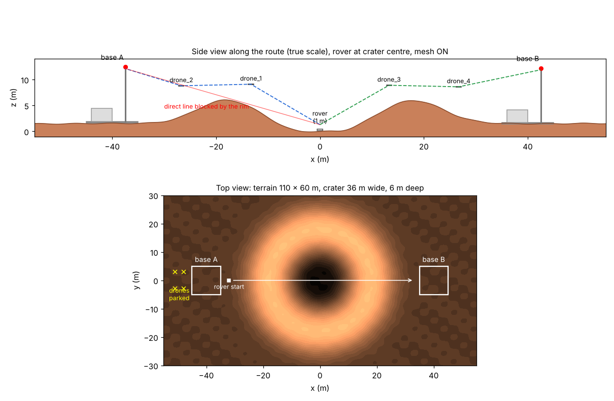
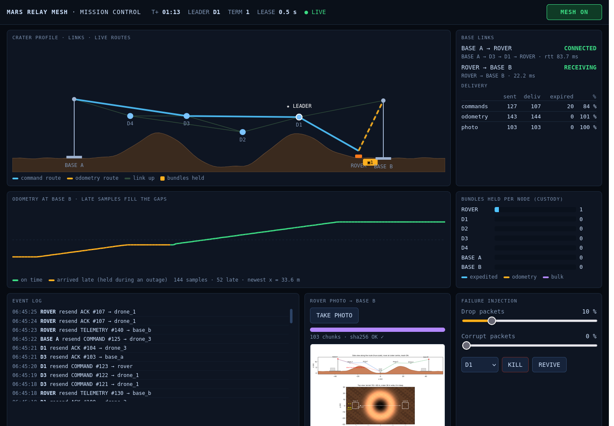

<!-- mars-mesh-readme -->
# Mars Rover Relay Mesh — Simulation

A ROS 2 + Gazebo simulation of a rover that loses contact with its base station inside a crater. A team of 4 relay drones forms a **mesh network** (our own protocol, on **[Zenoh](https://zenoh.io)**) that keeps the rover connected to **two base stations**: base A drives the rover, and base B receives its odometry.

**v3 (this branch):** the mesh works like NASA's **Delay/Disruption Tolerant Networking (DTN)**: hop-by-hop custody transfer, store and forward, per-packet lifetimes, priorities, assigned routes, a coordinator that runs on an **elected leader drone**, a rover photo sent in chunks, and a mission-control **web dashboard**. What changed from v2 and where the work stands: [`docs/V3_CHANGES.md`](docs/V3_CHANGES.md).

   



**Contents:** [1 Idea](#1-the-idea) · [2 Status](#2-what-works-now) · [3 Setup](#3-setup-on-a-new-laptop-once) · [4 Run the demo](#4-run-the-demo) · [5 World](#5-the-world-simulation-reference) · [6 How the network works](#6-how-the-network-works) · [7 Programs](#7-programs-and-commands) · [8 Where to plug in your part](#8-where-to-plug-in-your-part) · [9 Changing things](#9-changing-things) · [10 Repo layout](#10-repository-layout) · [11 Team workflow](#11-team-workflow-git) · [12 Troubleshooting](#12-troubleshooting) · [13 Roadmap](#13-roadmap)

---

## 1. The idea

```
   base A ─────────────── (crater) ─────────────── base B
  commands                                       receives odometry
     ▲    ✈ drone_2 ── ✈ drone_1        ✈ drone_3 ── ✈ drone_4    │
     └──────┘             \             /                └────────┘
                           \  rover  ●  /      the crater rim blocks every
                              (crater floor)   direct line to both bases
```

1. The **rover** starts next to **base A** and drives through a crater to **base B**.
2. Base A sends the rover **velocity commands**, and the rover answers each one with an **ACK**. The rover sends its **odometry** to base B.
3. Radio links only work with **line of sight over the terrain** and within **32 m**. Inside the crater the rim blocks both bases, so the rover stops (safety watchdog).
4. Switch the **mesh network ON** (dashboard toggle). The leader drone moves the 4 drones to relay positions, forming one chain to each base. Both links come back, the rover drives on, and base B gets odometry **all the way to the end**: samples held during the outage arrive late instead of being lost.
5. A failure injector can corrupt or drop packets, or kill a drone. CRC checks catch every broken packet, custody transfer resends lost ones, a new leader takes over in about 2 s, and nothing crashes.

## 2. What works now

| Part | What it does | Package (`src/`) | Status |
|---|---|---|---|
| World | 110 × 60 m crater terrain, rover, 4 drones, **2 base stations** | `mars_sim` | ✅ |
| Shared definitions | Unit names, layout, Zenoh keys, packet format + CRC32 | `mesh_common` | ✅ |
| Link model | Line of sight over the real terrain + radio range → which links are up | `mesh_link_model` | ✅ |
| Radio channel | Delivers a packet only to units with a working link | `mesh_link_model` | ✅ |
| Failure injection | **Stand-in only** (`passthrough_injector`: corrupt / drop for tests). Full module still to come | `mesh_link_model` → `failure_injection` | 🟡 |
| Mesh protocol v3 (DTN) | One node per unit: custody transfer, store and forward, lifetimes, priorities, routed bundles, CRC check, COMMAND / ACK / TELEMETRY / photo | `mesh_protocol` | ✅ |
| Coordinator (leader drone) | Lease election among the drones; the leader plans drone positions and the route table, follows the rover | `mesh_protocol` | ✅ |
| Mission autopilot | Base A drives the rover from base A to base B over the mesh | `mesh_protocol` | ✅ |
| Monitor | Live text view of both bases, links and counters | `mesh_protocol` | ✅ |
| Mission-control dashboard | Web page: crater map with live routes, held bundles, delivery rates, late odometry, event log, photo, failure controls | `mesh_dashboard` | ✅ |
| Self-test | Whole demo without Gazebo, 36 checks (~6 min) | `mesh_protocol` | ✅ |

Gazebo is reached with the **Gazebo Python bindings** (`gz.transport13`): positions come from `/world/mars_world/pose/info`, the rover is driven on `/rover/cmd_vel`, and drones move with the `set_pose` service. No ROS 2 bridge is needed for the demo.

## 3. Setup on a new laptop (once)

**You need:** Ubuntu 24.04 (dual boot / native is best; WSL2 works too) and about 15 GB free.

> 📶 **On campus Wi-Fi?** If a download fails with `SSL certificate problem: self-signed certificate`, use a phone hotspot for the setup.

Open a terminal (`Ctrl + Alt + T`) and run each block in order.

**Step 1: Language settings** (ROS 2 needs UTF-8)
```bash
sudo apt update && sudo apt install -y locales
sudo locale-gen en_US en_US.UTF-8
sudo update-locale LC_ALL=en_US.UTF-8 LANG=en_US.UTF-8
export LANG=en_US.UTF-8
```

**Step 2: Add the ROS 2 package source**
```bash
sudo apt install -y software-properties-common curl
sudo add-apt-repository -y universe
export ROS_APT_SOURCE_VERSION=$(curl -s https://api.github.com/repos/ros-infrastructure/ros-apt-source/releases/latest | grep -F "tag_name" | awk -F'"' '{print $4}')
curl -L -o /tmp/ros2-apt-source.deb "https://github.com/ros-infrastructure/ros-apt-source/releases/download/${ROS_APT_SOURCE_VERSION}/ros2-apt-source_${ROS_APT_SOURCE_VERSION}.$(. /etc/os-release && echo ${UBUNTU_CODENAME:-${VERSION_CODENAME}})_all.deb"
sudo dpkg -i /tmp/ros2-apt-source.deb
```

**Step 3: ROS 2 Jazzy + build tools**
```bash
sudo apt update && sudo apt upgrade -y
sudo apt install -y ros-jazzy-desktop ros-dev-tools git
echo "source /opt/ros/jazzy/setup.bash" >> ~/.bashrc
source ~/.bashrc
```

**Step 4: Gazebo Harmonic + the ROS–Gazebo packages**
```bash
sudo curl https://packages.osrfoundation.org/gazebo.gpg --output /usr/share/keyrings/pkgs-osrf-archive-keyring.gpg
echo "deb [arch=$(dpkg --print-architecture) signed-by=/usr/share/keyrings/pkgs-osrf-archive-keyring.gpg] http://packages.osrfoundation.org/gazebo/ubuntu-stable $(lsb_release -cs) main" | sudo tee /etc/apt/sources.list.d/gazebo-stable.list > /dev/null
sudo apt update && sudo apt install -y gz-harmonic ros-jazzy-ros-gz
```
> ⚠️ Use **Gazebo Harmonic** (`gz sim`) only. Do **not** install Gazebo Classic (`gazebo`, `gazebo11`, `gazebo_ros`).

**Step 5: Python parts used by the mesh** (Gazebo Python bindings, numpy, PyQt6, Zenoh)
```bash
sudo apt install -y python3-gz-transport13 python3-gz-msgs10 python3-numpy python3-pyqt6 python3-pip
pip install --user --break-system-packages eclipse-zenoh
```

**Step 6: Check everything works.** Open a **new** terminal:
```bash
echo $ROS_DISTRO                                               # → jazzy
gz sim --version                                               # → Gazebo Sim, version 8.x
python3 -c "import zenoh, numpy, gz.transport13; print('python OK')"
python3 -c "import PyQt6.QtWidgets; print('PyQt6 OK')"
```

**Step 7: Get access + log in to GitHub.** The repo is **private**. Ask the owner to add you (repo → Settings → Collaborators), accept the invite, then:
```bash
sudo apt install -y gh
git config --global user.name "Your Name"
git config --global user.email "you@example.com"        # the email on your GitHub account
gh auth login --hostname github.com --git-protocol https --web
gh auth setup-git
```

**Step 8: Clone, build, test.** This repository **is** the ROS 2 workspace. Always clone it into `~/mars_ws`:
```bash
git clone https://github.com/Project-Kratos-28/auto_openday_mesh_networking_project.git ~/mars_ws
cd ~/mars_ws
colcon build --symlink-install
source install/setup.bash
echo "source ~/mars_ws/install/setup.bash" >> ~/.bashrc    # optional: every new terminal knows our packages
ros2 run mesh_protocol selftest                            # ~6 min, should end with 36/36 checks passed
```

## 4. Run the demo

Open 4 terminals. In **each** one run `cd ~/mars_ws && source install/setup.bash` first (skip this if you added it to `~/.bashrc`).

| Terminal | Command | What it is |
|---|---|---|
| T1 | `ros2 launch mars_sim sim.launch.py` | Gazebo with the crater world (press ▶ if paused) |
| T2 | `ros2 launch mesh_protocol mesh.launch.py` | link model, radio, injector, 7 mesh nodes (the drones elect a leader). **Mesh starts OFF** |
| T3 | `ros2 run mesh_dashboard dashboard` | mission-control dashboard: open **http://localhost:8080** (mesh toggle, photo, failure controls) |
| T4 | `ros2 run mesh_protocol mission` | base A drives the rover to base B (1 m/s, about 70 s) |

Optional T5: `ros2 run mesh_protocol mesh_monitor` (text view of everything).

**What you'll see:**

1. **Mesh OFF.** Base A is CONNECTED (`base_a → rover`) and base B shows NO DATA.
2. **Link lost.** About 6 m past the rim the terrain blocks base A. Base A shows NO CONNECTION, and the rover stops after 2 s (safety watchdog).
3. **Flip the toggle ON.** Base A sends MESH_CMD to the leader drone, which moves the drones to relay spots one at a time. Base A is connected again and base B starts RECEIVING odometry, first the samples held in the rover during the outage (amber in the dashboard), then live ones. The rover drives on.
5. **Try the failure controls.** Kill the leader drone: another takes over in about 2 s. Drop 10–20 % of packets: resends go up, nothing is lost. Take a photo: it arrives in chunks and is checked with sha256.
4. **Follow.** The drones are moved ahead of the rover, one at a time, so neither chain ever breaks. Near base B all 4 drones form one chain back to base A.

To get odometry for the **whole** trip, switch ON before starting T4 (or launch with `mesh:=on`). In Gazebo, scroll out until both base stations are visible, or right-click `primary_rover` in the Entity Tree → **Follow**.



**Without Gazebo** (fake rover, good for working on the protocol or dashboard):
```bash
ros2 launch mesh_protocol mesh.launch.py fake:=true mission:=true dashboard:=true
```

## 5. The world (simulation reference)

**World name:** `mars_world` · gravity **3.71 m/s²** (Mars) · metres · crater centre = origin `(0, 0)` · route along the x axis.

| Entity | Gazebo name | Mesh name | Position (x, y, z) | Notes |
|---|---|---|---|---|
| Terrain | `mars_crater` | — | — | 110 × 60 m. Crater 36 m wide: floor z = 0, rim top z = 6 at r = 18 m, plain z ≈ 1.5 |
| Base A | `base_station` | `base_a` | (-40, 0, 1.62) | Sends commands. 10 × 10 m pad, antenna ≈ 10.5 m above the pad |
| Base B | `base_station_2` | `base_b` | (40, 0, 1.38) | Receives odometry |
| Rover | `primary_rover` | `rover` | (-32, 0, 1.82) | 1 m, diff drive, faces +x. Antenna 1.3 m up |
| Drones | `drone_1` … `drone_4` | same | parked at (-48, ±3), (-51, ±3), 3 m up | Static (hover where placed), moved with `set_pose` |

- **Radio:** a link is up when the distance is ≤ **32 m** and the straight line between the two antennas stays **0.5 m above the ground** everywhere.
- **Bases A ↔ B** (80 m) can never talk directly.
- **Rover ↔ base A** breaks at x ≈ -11.5 (terrain).

Gazebo topics and services used:

| Name | Type | Used for |
|---|---|---|
| `/rover/cmd_vel` | `gz.msgs.Twist` | drive the rover (sent by the rover's mesh node) |
| `/rover/odom` | `gz.msgs.Odometry` | rover wheel odometry (sent to base B) |
| `/world/mars_world/pose/info` | `gz.msgs.Pose_V` | true positions of all units (link model) |
| `/world/mars_world/set_pose` | service `gz.msgs.Pose` | teleport drones (each drone moves itself) |

## 6. How the network works

### Packet path

A packet never goes straight from one unit to another:
```
 [unit node] ─ mesh/<u>/tx ─► radio channel ─ mesh/<v>/air ─► failure injector ─ mesh/<v>/rx ─► [unit v node]
                              (only to units with a                  (corrupt / drop)
                               working link: mesh/links)
 Gazebo poses ─► link model ─► mesh/links, mesh/positions    (5 times a second)
```

### Units and roles

| Mesh name | Role |
|---|---|
| `base_a` | **Commander.** Turns `mesh/base_a/cmd` into COMMAND packets, pings the rover every 1 s when idle, and publishes every ACK on `mesh/base_a/acks` |
| `rover` | Applies COMMANDs, answers each with an ACK, sends odometry (TELEMETRY) to base B every 0.5 s. **Watchdog:** stops if no drive command for 2 s |
| `base_b` | **Receiver.** Publishes the rover's odometry on `mesh/base_b/telemetry` |
| `drone_1` … `drone_4` | **Relays** (when the leader's route table names them). One of them is the **leader**: it plans where the drones go and computes the route table |

### Protocol rules, v3 DTN (`mesh_protocol/mesh_node.py`, `store.py`, `routing.py`, `leader.py`)
- **HELLO** every 0.5 s (TTL 1, never forwarded). A neighbour is gone after 1.5 s without one.
- **Routed bundles** (`COMMAND`, `ACK`, `TELEMETRY`, `PHOTO_REQ`, `PHOTO_CHUNK`) go hop by hop. The next hop comes from the leader's route table (or the destination itself if there is no route and it is in range). A node never hands a bundle to a next hop it can't hear.
- **Custody transfer:** the sender keeps the bundle in its **store** until the next hop answers with `CUSTODY_ACK`, and resends after 0.3 s, doubling up to 2 s. The receiver always acks (even duplicates) and then holds the bundle itself.
- **Store and forward:** no usable next hop = the bundle waits in the store (max 500; when full the oldest bulk bundle goes first).
- **Lifetime:** every bundle expires (`COMMAND` 1 s, below the rover's 2 s watchdog, so it never acts on old orders; `TELEMETRY` 120 s, so odometry arrives late instead of being lost; photo chunks 300 s).
- **Priority:** expedited (commands, control) → normal (odometry) → bulk (photo); each node sends at most 40 bundles/s.
- **Control floods** (`STATUS`, `LEADER`, `MESH_CMD`): duplicate filter + TTL, passed on by every unit, no custody (they repeat every 0.5–1 s).
- **Duplicate filter** on `(src, type, seq)`; **TTL** 8 as a hop limit; **CRC32 + parse check:** broken packets are counted (`bad_crc`) and dropped. They never crash a node.

### Packet format (JSON, defined in `mesh_common`)
```json
{"src": "rover", "dst": "base_b", "next_hop": "drone_4", "seq": 42, "ttl": 7,
 "path": ["rover", "drone_3"], "type": "TELEMETRY", "sent_time": 1729071234.5,
 "lifetime": 120, "priority": 1,
 "payload": {"odom": {"x": 1.2, "y": 0.0, "yaw": 0.01, "v": 1.0}, "truth": {"pos": [1.2, 0.0, 0.1]},
             "moving": true, "battery": 99.5},
 "crc32": 3735928559}
```
`type` is `HELLO`, `CUSTODY_ACK` (one hop), `COMMAND` (base A → rover, e.g. `{"linear": 1.0, "angular": 0.0}` or `{"ping": true}`), `ACK` (rover → base A), `TELEMETRY` (rover → base B), `PHOTO_REQ` / `PHOTO_CHUNK`, or the control floods `STATUS` (position + neighbours), `LEADER` (heartbeat: term, mode, route table, drone targets) and `MESH_CMD` (on/off).

### Coordinator on the leader drone (`mesh_protocol/leader.py`)
**Election:** the leader floods a `LEADER` heartbeat every 0.5 s (lease 2 s). A drone that hears none for 2 s + a random 0–0.5 s, and is the lowest-id drone it has heard from in the last 2 s, becomes leader with `term + 1`. A leader steps down on a higher term, or the same term from a lower id. A new leader inherits the mode and drone targets from the last heartbeat. Base A republishes the newest heartbeat on `mesh/coordinator/state`.

| Mode | Behaviour |
|---|---|
| `off` (default) | Drones parked behind base A, not used as relays. Direct links only |
| `on` | Drones deploy **at once**, wherever the rover is, and follow it |

The dashboard / `mesh_ctl` asks base A, which sends `MESH_CMD` to the leader every second until a heartbeat shows the new mode. While deployed, the leader works like this (using positions **reported** in `STATUS`, never true positions):
- **Checks:** every 0.5 s it tests both chains, for where the rover is now and where it'll be in 3 s.
- **Re-plans:** when a chain would break, or after the rover moves 8 m.
- **Planner** (`mesh_link_model/planner.py`): for each base, it tries 0, 1, 2… drones spaced along the line rover → base, at 3 / 6 / 10 / 15 m above the ground. It uses the fewest that give every hop line of sight and range, and spare drones go to the chain with the longest hop, so all 4 always help.
- **Moving drones:** one target at a time, in an order that keeps both chains working at every step; each drone teleports itself to its target. Drones with no `STATUS` for 2 s count as dead and are left out.
- **Route table:** shortest hop count (ties: better links) over the links the leader works out from positions + range + line of sight on the terrain map, so routes change the moment a move is ordered.

### Zenoh keys
| Key | From → To | Contents |
|---|---|---|
| `mesh/<unit>/tx` · `/air` · `/rx` | see packet path | raw packets |
| `mesh/links` | link model → all | `{"links": [{"a","b","up","distance","in_range","los","quality"}]}` |
| `mesh/positions` | link model → all | true `x, y, z` and `yaw` of every unit |
| `mesh/stats/<unit>` | each node → dashboard | v2 counters + `held` (by priority), `custody_sent/acked`, `retransmits`, `expired`, `dropped_full`, `by_type`, `routes`, `leader`, `term`, `killed` |
| `mesh/events` | each node → dashboard | one event: retransmit, expired, election, route change, photo, killed / revived |
| `mesh/base_a/cmd` | mission, dashboard → base A | velocity command `{"linear", "angular"}` |
| `mesh/base_a/acks` | base A → dashboard | every ACK: round trip, command route, ACK route |
| `mesh/base_b/telemetry` | base B → dashboard | odometry + route + delay + `late` |
| `mesh/base_b/photo_cmd` · `mesh/base_b/photo` | dashboard → base B · base B → dashboard | take a photo · progress, then the image + sha256 `ok` |
| `mesh/coordinator/cmd` | dashboard, `mesh_ctl` → base A | `on` / `off` |
| `mesh/coordinator/state` | base A → dashboard | the newest `LEADER` heartbeat: leader, term, mode, state, chains, drone targets, routes |
| `mesh/mission/status` | mission → dashboard | rover x, progress %, assists |
| `mesh/failure/control` | dashboard, terminal → injector, nodes | e.g. `{"corrupt_probability": 0.2, "drop_probability": 0.05}`, `{"kill": "drone_2"}`, `{"revive": "drone_2"}` |
| `mesh/failure/events` | injector → dashboard | each corrupt / drop event |

All programs connect only on **`127.0.0.1`** (one hub at `tcp/127.0.0.1:7447`, multicast off), so nothing leaks onto hostel Wi-Fi. That also means everything must run on **one laptop** for now (see section 12).

## 7. Programs and commands

| Command | What it does |
|---|---|
| `ros2 launch mesh_protocol mesh.launch.py` | Starts everything below except the mission and the dashboard. Options: `mesh:=on`, `dashboard:=true`, `mission:=true`, `fake:=true` (no Gazebo), `injector:=none` (use the real injector), `sim:=true` (also start Gazebo) |
| `ros2 run mesh_dashboard dashboard [--port 8080]` | Mission-control dashboard on http://localhost:8080 (localhost only: the controls have no login) |
| `ros2 run mesh_protocol mesh_ctl on\|off` | The mesh switch from a terminal (the dashboard toggle follows it) |
| `ros2 run mesh_protocol mission [--speed 0.5] [--no-assist]` | Drive base A → base B. Assist: if the rover gets commands but is stuck for 6 s, it's lifted 1.5 m forward |
| `ros2 run mesh_protocol mesh_monitor` | Live text view |
| `ros2 run mesh_protocol send_cmd 1.0 [0.2]` | One drive command from base A (0 = stop) |
| `ros2 run mesh_protocol move_unit drone_1 0 0 12` / `move_unit home` | Teleport a unit / park all drones (`--fake` without Gazebo) |
| `ros2 run mesh_protocol selftest` | Whole demo without Gazebo, 36 checks |
| `mesh_node --unit drone_1 [--mesh on] [--fake]` · `ros2 run mesh_link_model link_model` / `radio_channel` / `passthrough_injector` | Single pieces (normally started by the launch file) |

## 8. Where to plug in your part

**Failure injection team:**
- Write `src/failure_injection`. It subscribes to `mesh/*/air`, changes, drops or delays the raw bytes, and publishes to `mesh/<unit>/rx`. Copy the interface of `mesh_link_model/passthrough_injector.py`: same keys, plus live settings on `mesh/failure/control` and events on `mesh/failure/events`.
- Run the mesh with `injector:=none` and start yours instead.
- Never decode packets in the injector. Flip bits in the bytes; the nodes must survive it.

**Dashboard (`src/mesh_dashboard`):**
- `bridge.py` holds all Zenoh in/out: `snapshot()` (everything the page draws), `events()`, `set_mesh`, `set_failure`, `take_photo`. Never call Zenoh anywhere else.
- `server.py` is a standard-library HTTP server: the page, a Server-Sent Events stream (`/events`), and `POST /api/mesh|failure|photo` (inputs are checked; unknown keys get 400).
- `static/` is the page: plain HTML/CSS/JS + SVG, **no external URLs** (venue Wi-Fi), checked by `test/test_server.py`.

**Protocol team:**
- `mesh_node.py` (one class, one copy per unit) wires the pure-logic modules to Zenoh: `store.py` (custody store), `routing.py` (route table), `leader.py` (election + the leader's planning), `photo.py` (chunking). Each has plain-assert tests in `test/` (`python3 -m pytest src/*/test`).
- Keep the packet format and keys in `mesh_common`. Run `ros2 run mesh_protocol selftest` before pushing.

**Simulation:** see section 9.

## 9. Changing things

| I want to change... | Edit | Then |
|---|---|---|
| Crater size / depth / bumps, terrain size | numbers at the top of `src/mars_sim/scripts/generate_crater.py` | regenerate (below) |
| Where the bases, rover or parked drones start | `src/mars_sim/scripts/build_relay_world.py` **and** `START_XY` in `src/mesh_common/mesh_common/__init__.py` | regenerate (below) |
| Radio range, antenna heights, rover speed, relay heights, goal | `src/mesh_common/mesh_common/__init__.py` (`RADIO_RANGE`, `ANTENNA_HEIGHT`, `ROVER_SPEED`, `RELAY_HEIGHTS`, `REPLAN_DISTANCE`, `GOAL_X`) | relaunch |
| Rover / drone / base shape | `src/mars_sim/models/<model>/model.sdf` | relaunch |
| Gravity, sun, sky | `build_relay_world.py` (the world file is generated) | regenerate |

Regenerate the terrain and world:
```bash
cd ~/mars_ws/src/mars_sim && python3 scripts/generate_crater.py && python3 scripts/build_relay_world.py
cd ~/mars_ws && colcon build --symlink-install
ros2 run mesh_protocol selftest              # check the demo still works
```
- **Never hand-edit** `worlds/mars_crater.sdf` or `models/mars_crater/meshes/crater.obj`: both are generated. Commit them **together with** the scripts.
- Changed the crater, radio range or positions? Check the story still works: the rover must lose base A inside the crater, and the bases must not see each other. Run the self-test, and update section 5.
- Keep the names stable (`mars_world`, `primary_rover`, `drone_1…4`, `base_station`, `base_station_2`, topics, Zenoh keys). Other packages depend on them.

## 10. Repository layout

```
mars_ws/                              ← repo root = ROS 2 workspace
├── README.md                         ← this file
├── ERRORS.md                         ← problems we hit + how we fixed them
├── docs/
│   ├── RELAY_DEMO.md                 ← short demo guide
│   └── images/                       ← pictures used in the README
└── src/
    ├── mars_sim/                     ← Gazebo world, models, launch (ament_cmake)
    │   ├── scripts/generate_crater.py    ← makes models/mars_crater/meshes/crater.obj
    │   ├── scripts/build_relay_world.py  ← makes worlds/mars_crater.sdf
    │   ├── worlds/  models/  launch/sim.launch.py
    ├── mesh_common/                  ← names, layout, Zenoh keys, packet format + CRC
    ├── mesh_link_model/              ← terrain + line of sight, link model, radio channel,
    │                                    relay planner, teleport helper, stand-in injector
    ├── mesh_protocol/                ← mesh node (DTN), store, routing, leader election, photo,
    │                                    mission, tools, self-test, launch
    └── mesh_dashboard/               ← mission-control web dashboard (server + offline page)
```
`build/`, `install/` and `log/` come from `colcon build` and are **not** in git.

## 11. Team workflow (git)

```bash
cd ~/mars_ws && git checkout main && git pull       # ALWAYS first
git checkout -b feature/<short-name>                # e.g. feature/failure-injection
# ... edit, then build and test:
colcon build --symlink-install && source install/setup.bash && ros2 run mesh_protocol selftest
git add -A && git commit -m "Add bit-flip injector" && git push -u origin feature/<short-name>
```
Then open a **Pull Request** on GitHub so someone checks it before it's merged.

Team rules:
- Pull before you start, push when you stop.
- One person per file at a time. Say in the group chat which file you're editing.
- Don't commit `build/`, `install/` or `log/`.

**If git says "conflict":** open the file, keep the right lines, delete the `<<<<<<<`, `=======` and `>>>>>>>` markers, then:
```bash
git add -A && git commit -m "Merge latest main" && git push
```
Not sure which version is right? Ask whoever made the other change.

## 12. Troubleshooting

| Problem | Fix |
|---|---|
| `ModuleNotFoundError: No module named 'zenoh'` | `pip install --user --break-system-packages eclipse-zenoh` |
| `No module named 'gz.transport13'` | `sudo apt install -y python3-gz-transport13 python3-gz-msgs10` |
| `No module named 'PyQt6'` | `sudo apt install -y python3-pyqt6` |
| `error: externally-managed-environment` (pip) | add `--break-system-packages` |
| `No module named mesh_common` / `Package 'mesh_protocol' not found` | `cd ~/mars_ws && source install/setup.bash` in that terminal |
| `[link_model] WARNING: no position yet` | Gazebo isn't running or is paused (press ▶). Check `gz topic -l \| grep pose` |
| Dashboard shows OFFLINE / no leader | Start T2 first; the drones elect a leader about 2 s after they start |
| Drones don't move | Check `gz service -l \| grep set_pose`; the world must be `mars_world` |
| Rover doesn't move | Mesh OFF and rover in the crater = no link (that's the demo). Otherwise press ▶ or check `gz topic -l \| grep rover` |
| `ASSIST #n` lines in the mission | The rover slipped on the ~31° crater wall and was lifted forward. Occasional is fine |
| `Address already in use` (port 7447) | An old launch is still running: `pkill -f "mesh_protocol\|mesh_link_model"` |
| Dashboard on another laptop sees nothing | On purpose: it listens on 127.0.0.1 only (its controls have no login). `--host 0.0.0.0` opens it to the network |
| Self-test fails | Read the `FAIL` lines and `/tmp/mesh_selftest.log` |
| `SSL certificate problem` on campus Wi-Fi | Use a phone hotspot |
| `Unable to find uri[model://...]` | `colcon build --symlink-install && source install/setup.bash` |
| Black window / crash | `sudo ubuntu-drivers install`, reboot |

More in [`ERRORS.md`](ERRORS.md).

## 13. Roadmap

- [x] World: crater terrain, rover, 4 drones, **2 base stations** (small demo scale)
- [x] Shared definitions (`mesh_common`): packet format + CRC32, unit names, Zenoh keys
- [x] Link model + radio channel: line of sight + range → `mesh/links`
- [x] Mesh protocol v1: flooding with TTL + duplicate filter
- [x] Mesh protocol v2: HELLO neighbours, roles, COMMAND / ACK / TELEMETRY, rover watchdog
- [x] Coordinator: mesh ON/OFF/AUTO, relay planning with all 4 drones, follow the rover without gaps
- [x] Mission: base A drives the rover to base B over the mesh
- [x] GUI placeholder with the mesh toggle (replaced in v3)
- [ ] Failure injection package: bit flips, drops, delay, kill / revive units, scripted failures
- [x] Protocol v3 (DTN): custody transfer, store and forward, lifetimes, priorities, routed bundles, re-routing when a drone fails
- [x] Coordinator on an elected leader drone (kill it: another takes over)
- [x] Mission-control web dashboard (map, routes, held bundles, delivery, late odometry, events, photo, failure controls)
- [x] Rover photo transfer in chunks with a sha256 check
- [ ] Drones that fly (velocity control) instead of teleporting
- [ ] Final demo: rover enters crater → link lost → mesh ON → both bases connected → corruption on → a drone fails → re-route
